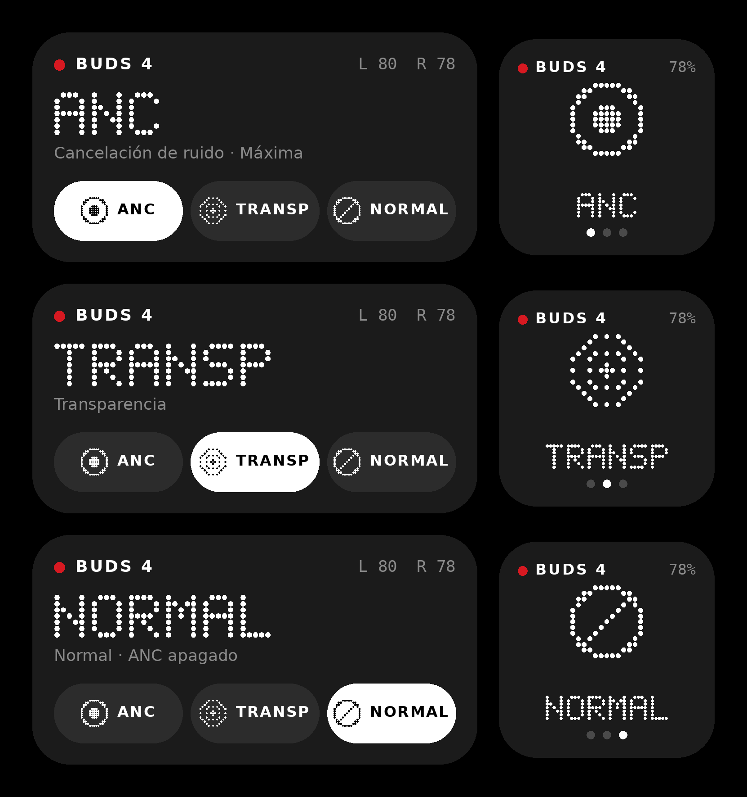
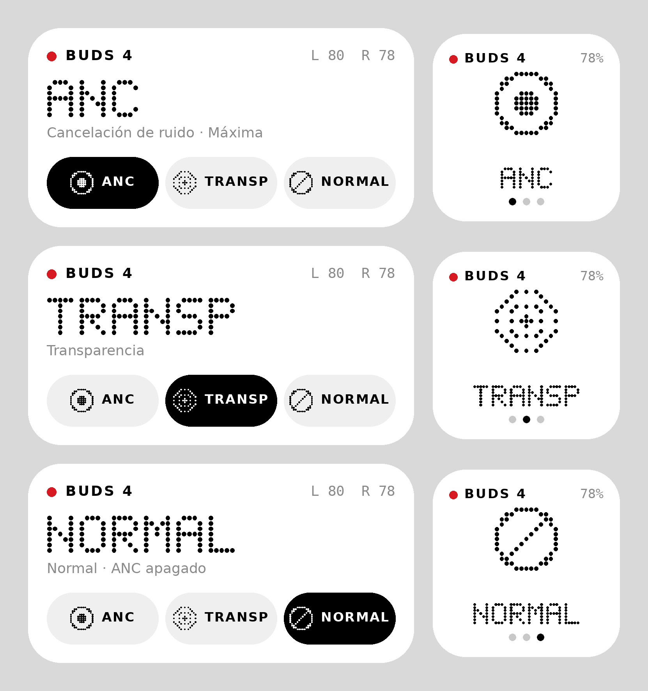

# Buds: widget Nothing OS para OnePlus Buds 4

Widget para el **Nothing Phone (2a)** con Nothing OS 4. Cambia los **OnePlus Buds 4** entre
**cancelación de ruido**, **transparencia** y **normal** (ANC apagado) desde la pantalla de
inicio, sin abrir la app de OnePlus.

| Oscuro | Claro |
|---|---|
|  |  |

## Qué incluye

- **Widget 4×2**: modelo, batería L/R, modo actual en matriz de puntos y tres botones tipo píldora.
- **Widget 2×2**: ícono del modo. Cada toque alterna ANC → Transparencia → Normal.
- **Tile de Ajustes rápidos**: el mismo ciclo desde la cortina de notificaciones.
- **App de configuración**: permisos, elección de audífonos, nivel de ANC y una consola para
  enviar comandos crudos al audífono.

El widget cambia de tamaño libremente. Android elige el diseño 2×2 o 4×2 según el espacio.

## Diseño (lenguaje visual de Nothing OS)

- Tarjeta monocroma (`#1B1B1B` en oscuro, `#FFFFFF` en claro) con el radio de esquina del launcher.
- Titular e íconos en **matriz de puntos**, como la tipografía Ndot y los íconos Glyph.
  Se dibujan en código (`ui/DotMatrix.kt`), sin fuentes propietarias.
- Un solo acento **rojo Nothing `#D71921`**: el punto de estado. Rojo = conectado, gris = sin conexión.
- Botones tipo píldora. El seleccionado se invierte (blanco sobre negro en modo oscuro).
- Texto secundario gris y en mayúsculas espaciadas.

## Cómo funciona (ingeniería inversa)

La app oficial habla con los audífonos por **RFCOMM** (puerto serie Bluetooth). Usa un
protocolo binario propio de OPPO/OnePlus llamado "HeyMelody". Para cambiar de modo basta una
trama de 12 bytes:

```
AA 0A 00 00 04 04 01 03 00 01 01 04   → transparencia
                 └cmd┘    └payload┘
```

El detalle completo está en **[PROTOCOLO.md](PROTOCOLO.md)**: formato de trama, comandos, bits
de cada modo y cómo verificarlo con un log HCI snoop. La implementación vive en
`app/src/main/java/.../protocol/HeyMelody.kt`, con tests en `app/src/test`.

También funciona con otros OnePlus que usan el mismo protocolo: Buds 3, Buds Pro 2/3,
Nord Buds 3/3 Pro/4/4 Pro y Buds Ace. La lista está en `Catalog`.

## Instalar

1. Descarga el APK desde **GitHub → Actions → "Buds widget (APK)" → artefacto
   `buds-widget-apk`**, o compílalo tú (abajo).
2. Instálalo en el teléfono y acepta "instalar apps desconocidas".
3. Abre **Buds** y concede el permiso de *Dispositivos cercanos*.
4. Elige tus audífonos (aparecen primero si se llaman "OnePlus Buds 4") y el nivel de ANC.
5. Pulsa **Añadir widget a la pantalla de inicio**, o mantén presionado el escritorio →
   Widgets → Buds.
6. Opcional: en la cortina, entra al modo de edición y arrastra el tile **Buds**.

### Compilar

```bash
cd 3.Widget-Buds-Nothing
./gradlew testDebugUnitTest   # tests del protocolo
./gradlew assembleRelease     # app/build/outputs/apk/release/app-release.apk
```

Requiere JDK 17 y Android SDK 36. El APK de release se firma con la clave debug para poder
instalarlo directamente.

`python3 tools/preview.py` regenera los íconos vectoriales y las imágenes de vista previa a
partir de los mismos glifos de `DotMatrix.kt`.

## Limitaciones y notas

- **No se probó con hardware real durante el desarrollo.** Los comandos y bits coinciden con
  BudsControl, que documenta pruebas con Buds 4 (canal 15 y transparencia informada en el
  bit 8), y con la disposición de oppo-pods. Si algo falla, la consola de la app muestra
  exactamente qué responden los audífonos.
- Cada acción abre el canal RFCOMM, envía el comando y lo cierra (≈ 0,5–1,5 s). No queda
  ningún servicio corriendo en segundo plano, así que no gasta batería.
- Si la app oficial de OnePlus/HeyMelody tiene el canal abierto en ese momento, la conexión
  puede fallar. Ciérrala o fuerza su detención.
- Si cambias el modo desde los audífonos (gesto de presión), el widget se actualiza cuando
  lo tocas, al reconectar los audífonos o cada 30 min.
- Proyecto educativo. No está afiliado a Nothing ni a OnePlus.
